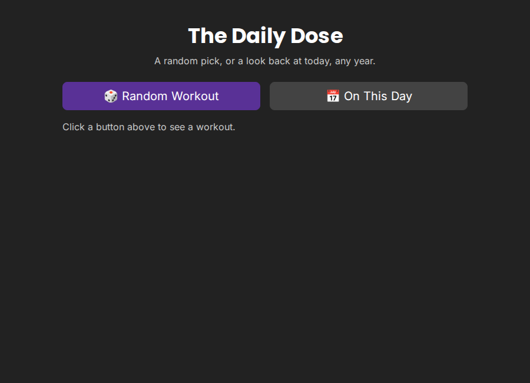

```{r}
#| label: setup
#| eval: true 
#| echo: false 
#| include: false
source("../_common.R")
```

I started storing my daily workouts on GitHub in 2020, and continued until about 2024. I logged almost every workout I did (1,001 total). In this post I'll cover how that log became [`daily-dose`](https://github.com/mjfrigaard/daily-dose), a small Shiny for Python app. We'll walk through the app's history, its architecture, and some design choices I made to keep it small.

{fig-align="center" width="85%"}

## Where the log came from

The log started as an R Markdown site in early 2022. Each year had its own page, and each workout sat under a dated `###` heading. Most entries were typed in markdown, but for a stretch of 2020, the workouts lived on a whiteboard, so I took a picture the board instead.

By 2024 I had 881 typed entries and 120 photos. I eventually noticed that I'd organized date (specifically), but I rarely browsed it year by year. I decided I wanted an app that could do two things: select a random workout, and look at what I did on **this** date in past years.

I rebuilt the website as [Shiny for Python](https://shiny.posit.co/py/) app-package on top. 

## How the pieces fit

I wanted the app to do the two things covered above (and nothing else). I thought of this in three layers: a build script, a pure Python core, and a thin Shiny app. The diagram below shows how a workout moves from its original source to the screen.

```{mermaid}
%%| fig-width: 6
%%| fig-align: 'center'
%%{init: {'theme': 'base', 'themeVariables': { 'fontFamily': 'monospace', "darkMode":false}}}%%
flowchart TD
    subgraph Src["<strong>Original log</strong>"]
        Rmd[/"Typed .Rmd entries"/]
        Photos[/"Whiteboard photos"/]
    end
    subgraph Build["<strong>build_workouts_data.py</strong>"]
        Parse("Parse dates<br>and checkboxes")
        Shrink("Rotate, resize,<br>save as JPEG")
        Dedup{"Text and photo<br>on one date?"}
    end
    subgraph Pkg["<strong>daily_dose package</strong>"]
        Json[("workouts.json")]
        Imgs[("www/images/")]
        Core[["core.py"]]
    end
    subgraph App["<strong>Shiny app</strong>"]
        Server("app.py")
        Card[["workout_card()"]]
    end
    Rmd -->|"i. read markdown"| Parse
    Photos -->|"ii. read png"| Shrink
    Parse --> Dedup
    Shrink --> Dedup
    Dedup -->|"iii. text wins"| Json
    Dedup -->|"iii. photo kept"| Imgs
    Json --> Core
    Core -->|"iv. launch app"| Server
    Server --> Card
    Imgs -.-> Card

    style Src fill:#FFFFFF,color:#000000,stroke:#333,stroke-width:1px,rx:10,ry:10
    style Build font-size:15px,fill:#FFFFFF,color:#000000,stroke:#333,stroke-width:1px,rx:10,ry:10
    style Pkg fill:#FFFFFF,color:#000000,stroke:#333,stroke-width:1px,rx:10,ry:10
    style App fill:#FFFFFF,color:#000000,stroke:#333,stroke-width:1px,rx:10,ry:10
    style Parse fill:#4CBB9D,color:#FFFFFF,rx:5,ry:5
    style Shrink fill:#4CBB9D,color:#FFFFFF,rx:5,ry:5
    style Dedup fill:#4CBB9D,color:#FFFFFF
    style Core fill:#4CBB9D,color:#FFFFFF
    style Server fill:#4CBB9D,color:#FFFFFF,rx:5,ry:5
    style Card fill:#4CBB9D,color:#FFFFFF
```

The build script runs by hand, only when the source files change. It writes every workout to a single JSON file that ships inside the package. The app reads that file once at startup.

The core is just two functions over a list of records. `random_workout()` picks one record, and `on_this_day()` returns every record that matches today's month and day:

```python
def on_this_day(workouts, today=None):
    target = today or date.today()
    matches = [
        w for w in workouts
        if int(w["date"][5:7]) == target.month
        and int(w["date"][8:10]) == target.day
    ]
    return sorted(matches, key=lambda w: w["date"], reverse=True)
```

## Design choices

As I mentioned above, the workouts were stored as markdown text and images. Below I'll cover how I dealt with these two types of files, and what I did to handle duplicates.

### One record shape

I could've have kept the markdown entries and photos in two collections, but I decided every workout would just be one record with a `date` and a `kind` (`"text"` or `"image"`). Both core functions work on a flat list without caring what the record holds. Only `workout_card()` checks `kind`, because only the card has to draw it.

### Text wins on shared dates

Some of the 2020 workouts had *both* a photo *and* a typed entry for the same session (don't ask me how). Keeping both would show one workout twice under **On This Day**. It would also give those dates double the odds in a random pick. I decided to preferentially write the build script to keep the typed entry, since these usually recorded the sets and reps (and the photo didn't).

```{mermaid}
%%| fig-width: 6
%%| fig-align: 'center'
%%{init: {'theme': 'base', 'themeVariables': { 'fontFamily': 'monospace', "darkMode":false}}}%%
flowchart TD
    Entry(["Next entry<br>(text or image)"])
    Seen{"Date already<br>stored?"}
    Swap{"Stored entry is an image<br>and this one is text?"}
    Store("Store this entry")
    Skip("Keep stored entry,<br>drop this one")
    Out[("One entry per date")]

    Entry --> Seen
    Seen -->|"no"| Store
    Seen -->|"yes"| Swap
    Swap -->|"yes"| Store
    Swap -->|"no"| Skip
    Store --> Out
    Skip --> Out

    style Entry fill:#FFFFFF,color:#000000,stroke:#333
    style Seen fill:#4CBB9D,color:#FFFFFF
    style Swap fill:#4CBB9D,color:#FFFFFF
    style Store fill:#4CBB9D,color:#FFFFFF,rx:5,ry:5
    style Skip fill:#4CBB9D,color:#FFFFFF,rx:5,ry:5
    style Out fill:#FFFFFF,color:#000000,stroke:#333
```

### Keep the markdown as written

I thought I'd be able to categorize the workout by type, but over the four years, I never settled on one markdown format for exercises or reps. Forcing them into structured fields would risk mangling any entry the parser misread. So the parser pulls out only the date and the done checkbox and keeps the rest verbatim.

The parser also fails loudly. Any line that looks like a date heading but doesn't match the strict pattern stops the build. I've found this to be better than silently merging that line into the entry above it.

### A core without Shiny

`core.py` never imports `shiny`, so it keeps both functions testable with plain `pytest`, with no running app. It also leaves `app.py` as thin glue: two buttons, two effects, and one render function.

```{mermaid}
%%| fig-width: 6
%%| fig-align: 'center'
%%{init: {'theme': 'base', 'themeVariables': { 'fontFamily': 'monospace', "darkMode":false}}}%%
flowchart TD
    User(["User clicks<br>button"])
    subgraph ShinyGrp["<strong>Imports shiny</strong>"]
        AppPy("app.py<br>buttons, effects, render")
        Card[["workout_card()"]]
    end
    subgraph CoreGrp["<strong>Plain Python (core.py)</strong>"]
        Load[["load_workouts()"]]
        Rand[["random_workout()"]]
        Today[["on_this_day()"]]
    end
    Tests(["pytest<br>tests/"])

    User --> AppPy
    AppPy --> Rand
    AppPy --> Today
    Load --> AppPy
    AppPy --> Card
    Tests -.-> Load
    Tests -.-> Rand
    Tests -.-> Today

    style ShinyGrp fill:#FFFFFF,color:#000000,stroke:#333,stroke-width:1px,rx:10,ry:10
    style CoreGrp font-size:15px,fill:#FFFFFF,color:#000000,stroke:#333,stroke-width:1px,rx:10,ry:10
    style User fill:#FFFFFF,color:#000000,stroke:#333
    style Tests fill:#FFFFFF,color:#000000,stroke:#333
    style AppPy fill:#4CBB9D,color:#FFFFFF,rx:5,ry:5
    style Card fill:#4CBB9D,color:#FFFFFF
    style Load fill:#4CBB9D,color:#FFFFFF
    style Rand fill:#4CBB9D,color:#FFFFFF
    style Today fill:#4CBB9D,color:#FFFFFF
```

I'm still new to Shiny for Python, so I used Shiny Core rather than Express, which keeps the UI and server in separate, explicit objects.

### Smaller photos

The original photos were phone PNGs, about 325MB for 120 images. Since the app ships as an installable package, the build script rotates, resizes, and saves each one as JPEG. The total dropped to about 21MB with no visible loss on handwriting.

### A shim for deployment

The app runs on [Posit Connect Cloud](https://docs.posit.co/connect-cloud/), which expects `app.py` and `requirements.txt` at the repo root. The package uses a `src` layout, so the root `app.py` is a small shim that imports the real app. 

```{r}
#| label: co_box_requirements
#| echo: false
#| results: asis
#| eval: true
co_box(color = "o", 
  header = "`requirements.txt`", 
  contents = "My first `requirements.txt` held only `-e .`, which failed because Connect Cloud can't resolve an editable install. It now lists the dependencies directly.")
```

## Recap

The `daily-dose` app-package successfully kept the two features I used and dropped the rest. I found processing the data (turning typed entries and photos into one record shape) in a Shiny-free core made the logic easy to test. I just used Shiny as a thin layer to put the outputs on the screen. Also--writing the documentation in [`great-docs`](https://posit-dev.github.io/great-docs/) was intuitive and fun because I use Quarto quite a bit. 

* [App on Posit Connect Cloud](https://mjfrigaard-daily-dose.share.connect.posit.cloud/)
* [Repo](https://github.com/mjfrigaard/daily-dose)
* [Docs](https://mjfrigaard.github.io/daily-dose/)
