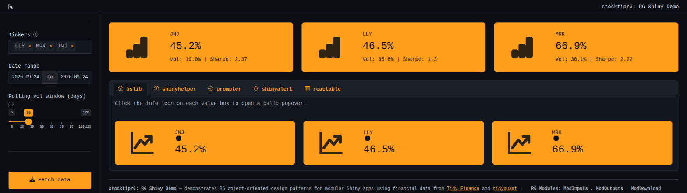
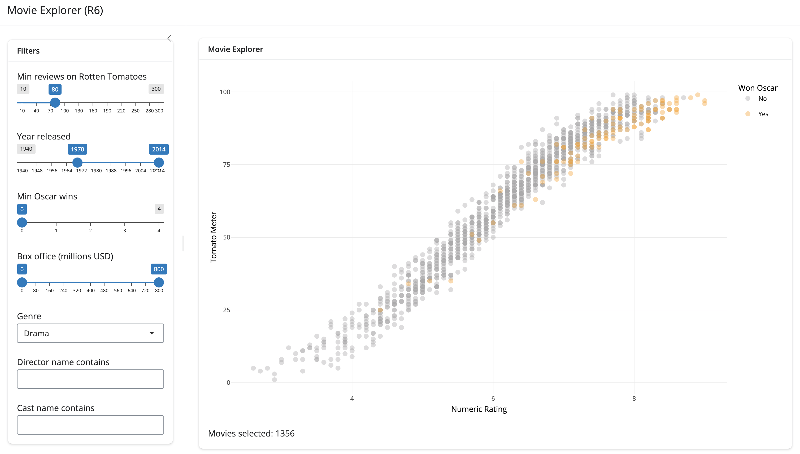

```{r}
#| label: setup
#| eval: true
#| echo: false
#| include: false
source("../_common.R")
options(scipen = 999)
library(quarto)
library(rmarkdown)
library(shiny)
library(R6)
library(ttdviewer)
```

As a Shiny app grows, I've found its state gets scattered across reactives, observers, and module arguments. Shiny's reactive model keeps the app working, but it doesn't tell you who owns what. `R6` classes give that state an owner: one object that bundles the data, the behavior, and the business logic.

In this post I'll walk through two Shiny app-packages that use `{R6}` in different places:

1. [`stocktipr6`](https://mjfrigaard.github.io/stocktipr6/) wraps every module in an `R6` class.
2. [`movexplR6`](https://mjfrigaard.github.io/movexplR6/) keeps its modules as functions and uses `R6` for the data layer.

I'll describe each app first, then compare the two designs, and finish with documentation and packaging practices that apply to both.

## What is `{R6}`?

`{R6}` is an object-oriented system that creates reference-based objects. Unlike `S3` or `S4` objects, `R6` objects are mutable and modified in place. They also support encapsulation, which means each class has public members (callable from outside the object) and private members (only reachable from inside it). If you've written classes in Python or Java, `R6` will feel familiar.

```{r}
#| eval: false
#| code-fold: false
install.packages("R6")
```

You've probably used `R6` objects without knowing it. [`shinytest2`](https://github.com/rstudio/shinytest2/blob/main/R/app-driver.R) builds its `AppDriver` with `R6`, and [`plumber2`](https://github.com/posit-dev/plumber2/blob/main/R/Plumber2.R) uses it to organize routers. Shiny's own session object is an `R6` class, so using `R6` in an app-package extends a pattern Shiny already relies on.

The diagram below shows the parts of an `R6` class that matter for the rest of this post.

```{mermaid}
%%| eval: true
%%| echo: false
%%| fig-align: 'center'
%%| fig-cap: 'Anatomy of an R6 class'
%%{init: {'theme': 'base', 'themeVariables': { 'fontFamily': 'monospace', "darkMode":true}}}%%

flowchart TD
    Gen(["<code>MyClass &lt;- R6::R6Class()</code>"])
    New("<code>MyClass$new()</code><br/>runs <code>initialize()</code>")
    subgraph Obj["<strong>One object</strong>"]
        Pub("<strong>public</strong><br/>fields and methods<br/>callers can use")
        Priv("<strong>private</strong><br/>fields and methods<br/>only the object can use")
    end

    Gen -->|"defines"| New
    New -->|"creates"| Obj
    Pub -->|"reads and writes"| Priv

    style Gen fill:#dfdfde,color:#000000
    style New fill:#4CBB9D,color:#FFFFFF,rx:5,ry:5
    style Pub fill:#4CBB9D,color:#FFFFFF,rx:5,ry:5
    style Priv fill:#FFFFFF,color:#000000,stroke:#333
    style Obj fill:#FFFFFF,color:#000000,stroke:#333,stroke-width:1px,rx:10,ry:10
```

The class generator defines the members, and `$new()` creates an object from it. Public methods are the object's interface; private members hold whatever the object needs to remember between calls.

## `stocktipr6`: `R6` Modules

`stocktipr6` is a stock dashboard. Users choose tickers and a date range, fetch prices from [`tidyquant`](https://business-science.github.io/tidyquant/), and compare performance across five tabs of tooltip, popover, help modal, and alert examples. A sidebar card downloads the results as an HTML or PDF report.

Access the code here: [mjfrigaard.github.io/stocktipr6](https://mjfrigaard.github.io/stocktipr6/)

{width='100%' fig-align='center'}

### App structure

Each module lives in a single file that holds one `R6` class. The tree below shows the key files; utility functions like `get_stock_prices()` and `summarise_performance()` live in their own files. The function-based version of this app ([`stocktipr`](https://mjfrigaard.github.io/stocktipr/)) splits each module into `mod_*_ui()` and `mod_*_server()` functions instead.

```{verbatim}
R/
├── app_server.R #<1>
├── app_ui.R #<2>
├── launch.R #<3>
├── ModDownload.R #<4>
├── ModInputs.R #<5>
├── ModOutputs.R #<6>
├── mod_hoverinfo.R #<7>
├── mod_tooltip.R #<8>
└── ... utility functions
```
1. Creates the module objects and connects their `$server()` methods
2. Creates the module objects and calls their `$ui()` methods
3. App entry point; calls `shinyApp()`
4. `R6` class for the report download card and its download handler
5. `R6` class for the sidebar inputs; returns a reactive list
6. `R6` class for the value boxes, tabs, and table
7. Hover text helper for `reactable` cells
8. Tooltip icon helper used in input labels

### Module anatomy

Every module in `stocktipr6` has the same shape. `initialize()` stores the module's `id` and builds a namespace function from it. Both values go into `private`, where `$ui()` and `$server()` read them.

```{mermaid}
%%| eval: true
%%| echo: false
%%| fig-align: 'center'
%%| fig-cap: 'An R6 module in stocktipr6'
%%{init: {'theme': 'base', 'themeVariables': { 'fontFamily': 'monospace', "darkMode":true}}}%%

flowchart TD
    New(["<code>ModInputs$new(id = 'inputs')</code>"])
    subgraph Mod["<strong>ModInputs object</strong>"]
        Init("<code>initialize()</code>")
        subgraph Private["<strong>private</strong>"]
            Id[("<code>id</code><br/>'inputs'")]
            Ns[("<code>ns()</code><br/><code>NS('inputs')</code>")]
        end
        UI("<code>$ui()</code><br/>input IDs from <code>ns()</code>")
        Server("<code>$server()</code><br/><code>moduleServer(id)</code>")
    end

    New --> Init
    Init -->|"stores"| Id
    Init -->|"builds"| Ns
    Ns --> UI
    Id --> Server

    style New fill:#dfdfde,color:#000000
    style Init fill:#4CBB9D,color:#FFFFFF,rx:5,ry:5
    style UI fill:#4CBB9D,color:#FFFFFF,rx:5,ry:5
    style Server fill:#4CBB9D,color:#FFFFFF,rx:5,ry:5
    style Id fill:#b3cde0,color:#000000
    style Ns fill:#b3cde0,color:#000000
    style Mod fill:#FFFFFF,color:#000000,stroke:#333,stroke-width:1px,rx:10,ry:10
    style Private fill:#E0F0ED,color:#000000,stroke:#4CBB9D
```

The `id` is set once, when the object is created. Inside an object, the UI and server can't disagree about the namespace because they read it from the same place. The skeleton below shows how little code this takes (view the full class [on GitHub](https://github.com/mjfrigaard/stocktipr6/blob/main/R/ModInputs.R)).

```{r}
#| eval: false
#| code-fold: false
ModInputs <- R6::R6Class(
  "ModInputs",
  public = list(
    initialize = function(id = "inputs") {
      private$id <- id
      private$ns <- shiny::NS(id)
    },
    ui = function(...) {
      bslib::sidebar(
        shiny::selectizeInput(private$ns("tickers"), "Tickers", choices = default_tickers),
        # ... dates, vol window, fetch button
        ...
      )
    },
    server = function() {
      shiny::moduleServer(private$id, function(input, output, session) {
        shiny::reactive(list(tickers = input$tickers, fetch = input$fetch))
      })
    }
  ),
  private = list(id = NULL, ns = NULL)
)
```

The `...` in `$ui()` lets another module's UI sit inside this sidebar. `app_ui()` uses it to place the download card under the inputs.

### How the modules connect

`app_ui()` and `app_server()` each create their own three module objects. The UI side calls `$ui()` on each one to build the page. The server side calls `$server()` and passes each module's return value to the next.

```{mermaid}
%%| eval: true
%%| echo: false
%%| fig-align: 'center'
%%| fig-cap: 'Data flow in stocktipr6'
%%{init: {'theme': 'base', 'themeVariables': { 'fontFamily': 'monospace', "darkMode":true}}}%%

flowchart TD
    User(["User"])
    subgraph Inputs["<strong>ModInputs</strong>"]
        In("tickers, dates,<br/>vol window, fetch")
    end
    InR[/"<code>inputs_r()</code>"/]
    subgraph Outputs["<strong>ModOutputs</strong>"]
        Prices("<code>prices_r()</code><br/><code>get_stock_prices()</code>")
        Returns("<code>returns_r()</code><br/><code>get_stock_returns()</code>")
        Perf("<code>perf_r()</code><br/><code>summarise_performance()</code>")
        Render("value boxes, tooltip<br/>tabs, <code>reactable</code>")
    end
    PerfR[/"<code>perf_r()</code>"/]
    subgraph Download["<strong>ModDownload</strong>"]
        Report("<code>downloadHandler()</code><br/>HTML or PDF report")
    end

    User --> In
    In -->|"i. returns"| InR
    InR -->|"ii. fetch triggers"| Prices
    Prices --> Returns
    Returns --> Perf
    Perf --> Render
    Perf -->|"iii. returns"| PerfR
    InR -->|"iv."| Report
    PerfR -->|"iv."| Report

    style User fill:#dfdfde,color:#000000
    style In fill:#4CBB9D,color:#FFFFFF,rx:5,ry:5
    style Prices fill:#4CBB9D,color:#FFFFFF,rx:5,ry:5
    style Returns fill:#4CBB9D,color:#FFFFFF,rx:5,ry:5
    style Perf fill:#4CBB9D,color:#FFFFFF,rx:5,ry:5
    style Render fill:#FFFFFF,color:#000000,stroke:#333
    style Report fill:#4CBB9D,color:#FFFFFF,rx:5,ry:5
    style InR fill:#fff0e8,color:#000000
    style PerfR fill:#fff0e8,color:#000000
    style Inputs fill:#FFFFFF,color:#000000,stroke:#333,rx:10,ry:10
    style Outputs fill:#FFFFFF,color:#000000,stroke:#333,rx:10,ry:10
    style Download fill:#FFFFFF,color:#000000,stroke:#333,rx:10,ry:10
```

Reactives only flow downstream. `ModOutputs` reads `inputs_r()` but can't change the inputs, and `ModDownload` reads both reactives without touching the private state of either upstream object. Most of the app's logic lives inside the `$server()` methods, so each module carries its own share of the work.

## `movexplR6`: `R6` Business Logic

`movexplR6` is a movie explorer built on the [Shiny Movie Explorer example](https://shiny.posit.co/r/gallery/start-simple/movie-explorer/). Users filter films by reviews, Oscars, year, box office, genre, director, and cast, then plot any two variables against each other.

Access the code here: [mjfrigaard.github.io/movexplR6](https://mjfrigaard.github.io/movexplR6/)

{width='100%' fig-align='center'}

### App structure

`movexplR6` keeps its Shiny modules as ordinary functions. Its one `R6` class, `MovieData`, owns the database connection and the filtering logic.

```{verbatim}
R/
├── launch_app.R #<1>
├── movies_server.R #<2>
├── movies_ui.R #<3>
├── MovieData.R #<4>
├── mod_filters.R #<5>
├── mod_plot.R #<6>
└── utils.R #<7>
```
1. App entry point; calls `shinyApp()`
2. Creates the `MovieData` object and connects the modules to it
3. Places `mod_filters_ui()` in the sidebar and `mod_plot_ui()` in the body
4. `R6` class for the SQLite connection, data loading, and filtering
5. Function-based filters module; returns a reactive list of selections
6. Function-based plot module; draws the scatter plot and movie count
7. Axis variables and other constants

### Class anatomy

`MovieData` has nothing to do with the UI. Its public members are the connection, the full data set, and two methods. Its private members load the data and clean up after the object.

```{mermaid}
%%| eval: true
%%| echo: false
%%| fig-align: 'center'
%%| fig-cap: 'The MovieData class in movexplR6'
%%{init: {'theme': 'base', 'themeVariables': { 'fontFamily': 'monospace', "darkMode":true}}}%%

flowchart TD
    New(["<code>MovieData$new(db_path)</code>"])
    DB[("<code>movies.db</code><br/>omdb + tomatoes")]
    subgraph Obj["<strong>MovieData object</strong>"]
        subgraph Public["<strong>public</strong>"]
            Con[("<code>con</code><br/>DBI connection")]
            All[("<code>all_movies</code><br/>data frame")]
            Filter("<code>$filter()</code>")
            Disc("<code>$disconnect()</code>")
        end
        subgraph Private["<strong>private</strong>"]
            Load[["<code>load_data()</code>"]]
            Fin[["<code>finalize()</code>"]]
        end
    end

    New -->|"i. connects"| Con
    Con --- DB
    New -->|"ii. calls"| Load
    Load -->|"joins and collects"| All
    Filter -->|"subsets"| All
    Fin -->|"calls"| Disc
    Disc -->|"closes"| Con

    style New fill:#dfdfde,color:#000000
    style DB fill:#b3cde0,color:#000000
    style Con fill:#b3cde0,color:#000000
    style All fill:#b3cde0,color:#000000
    style Filter fill:#4CBB9D,color:#FFFFFF,rx:5,ry:5
    style Disc fill:#4CBB9D,color:#FFFFFF,rx:5,ry:5
    style Load fill:#FFFFFF,color:#000000,stroke:#333
    style Fin fill:#FFFFFF,color:#000000,stroke:#333
    style Obj fill:#FFFFFF,color:#000000,stroke:#333,stroke-width:1px,rx:10,ry:10
    style Public fill:#E0F0ED,color:#000000,stroke:#4CBB9D
    style Private fill:#FFF8E7,color:#000000,stroke:#999
```

The database is read once. `load_data()` joins the `omdb` and `tomatoes` tables, keeps movies with at least 10 reviews, and collects the result into `all_movies`, so every call to `$filter()` subsets data that's already in memory. The private `finalize()` method closes the connection if the object is garbage collected before `$disconnect()` runs.

### How the modules connect

`movies_server()` creates one `MovieData` object per session and registers `$disconnect()` with `shiny::onStop()`. The modules never see the object. A reactive in `movies_server()` passes the filter values to `$filter()`, and the plot module receives the result.

```{mermaid}
%%| eval: true
%%| echo: false
%%| fig-align: 'center'
%%| fig-cap: 'Data flow in movexplR6'
%%{init: {'theme': 'base', 'themeVariables': { 'fontFamily': 'monospace', "darkMode":true}}}%%

flowchart TD
    User(["User"])
    subgraph Server["<strong>movies_server()</strong>"]
        MD("<code>MovieData$new()</code>")
        subgraph Filters["<strong>mod_filters_server()</strong>"]
            FIn("reviews, oscars, year,<br/>box office, genre,<br/>director, cast, axes")
        end
        FR[/"<code>filters()</code>"/]
        Movies("<code>movies()</code><br/>calls <code>movie_data$filter()</code>")
        subgraph Plot["<strong>mod_plot_server()</strong>"]
            Scatter("scatter plot and<br/>movie count")
        end
        Stop("<code>onStop()</code><br/>calls <code>$disconnect()</code>")
    end

    User --> FIn
    FIn -->|"i. returns"| FR
    FR -->|"ii. filter values"| Movies
    MD -->|"ii. data"| Movies
    Movies -->|"iii."| Scatter
    FR -.->|"iii. axes"| Scatter
    MD -.->|"iv. session ends"| Stop

    style User fill:#dfdfde,color:#000000
    style MD fill:#4CBB9D,color:#FFFFFF,rx:5,ry:5
    style FIn fill:#FFF8E7,color:#000000,stroke:#999
    style Scatter fill:#FFF8E7,color:#000000,stroke:#999
    style Movies fill:#4CBB9D,color:#FFFFFF,rx:5,ry:5
    style Stop fill:#FFFFFF,color:#000000,stroke:#333
    style FR fill:#fff0e8,color:#000000
    style Server fill:#FFFFFF,color:#000000,stroke:#333,rx:10,ry:10
    style Filters fill:#FFFFFF,color:#000000,stroke:#999
    style Plot fill:#FFFFFF,color:#000000,stroke:#999
```

The modules here are thin. `mod_filters_server()` returns the current selections, and `mod_plot_server()` draws whatever data it's given. Neither one knows a database exists.

## Comparing the Two Apps

Both apps use `R6` to give state an owner. They differ in which layer that owner sits in, and that choice shapes how each app handles namespaces, state, and debugging.

### Where does `R6` live?

The diagram below lines up the layers of each app. In `stocktipr6`, the `R6` classes are the modules. In `movexplR6`, the modules are functions and the `R6` class sits underneath them as the data layer.

```{mermaid}
%%| eval: true
%%| echo: false
%%| fig-align: 'center'
%%| fig-cap: 'Where R6 sits in each app'
%%{init: {'theme': 'base', 'themeVariables': { 'fontFamily': 'monospace', "darkMode":true}}}%%

flowchart TD
    subgraph S["<strong>stocktipr6</strong>"]
        direction TB
        SApp("<code>app_ui()</code> + <code>app_server()</code>")
        SMod("<strong>R6 modules</strong><br/><code>ModInputs</code>, <code>ModOutputs</code>,<br/><code>ModDownload</code>")
        SFun[["utility functions<br/><code>get_stock_prices()</code>, etc."]]
        SApp --> SMod --> SFun
    end
    subgraph M["<strong>movexplR6</strong>"]
        direction TB
        MApp("<code>movies_ui()</code> + <code>movies_server()</code>")
        MMod("function modules<br/><code>mod_filters</code>, <code>mod_plot</code>")
        MData("<strong>R6 data layer</strong><br/><code>MovieData</code>")
        MApp --> MMod
        MApp --> MData
    end

    style SMod fill:#4CBB9D,color:#FFFFFF,rx:5,ry:5
    style MData fill:#4CBB9D,color:#FFFFFF,rx:5,ry:5
    style SApp fill:#FFFFFF,color:#000000,stroke:#333
    style MApp fill:#FFFFFF,color:#000000,stroke:#333
    style SFun fill:#FFFFFF,color:#000000,stroke:#333
    style MMod fill:#FFF8E7,color:#000000,stroke:#999
    style S fill:#FFFFFF,color:#000000,stroke:#333,rx:10,ry:10
    style M fill:#FFFFFF,color:#000000,stroke:#333,rx:10,ry:10
```

`stocktipr6` puts the structure around the Shiny code. `movexplR6` puts it around the data, and leaves the Shiny code as plain functions.

### Namespaces

A Shiny module only works when its UI and server use the same namespace `id`. The two apps make that match in different ways.

```{mermaid}
%%| eval: true
%%| echo: false
%%| fig-align: 'center'
%%| fig-cap: 'How R6 module patterns matches the UI and server namespace'
%%{init: {'theme': 'base', 'themeVariables': { 'fontFamily': 'monospace', "darkMode":true}}}%%

flowchart TD
    subgraph R6["<strong>R6 module</strong>"]
        RNew(["<code>ModInputs$new('inputs')</code>"])
        RId[("<code>private$id</code>")]
        RUI("<code>$ui()</code>")
        RSrv("<code>$server()</code>")
        RNew --> RId
        RId --> RUI
        RId --> RSrv
    end

    style RNew fill:#dfdfde,color:#000000
    style RId fill:#b3cde0,color:#000000
    style RUI fill:#4CBB9D,color:#FFFFFF,rx:5,ry:5
    style RSrv fill:#4CBB9D,color:#FFFFFF,rx:5,ry:5
    style R6 fill:#FFFFFF,color:#000000,stroke:#333,rx:10,ry:10

```

In an `R6` module, both methods read the `id` from one private field. 

```{mermaid}
%%| eval: true
%%| echo: false
%%| fig-align: 'center'
%%| fig-cap: 'How function module patterns matche the UI and server namespace'
%%{init: {'theme': 'base', 'themeVariables': { 'fontFamily': 'monospace', "darkMode":true}}}%%

flowchart TD
    subgraph Fn["<strong>Function module</strong>"]
        FUI("<code>mod_filters_ui('filters')</code>")
        FSrv("<code>mod_filters_server('filters')</code>")
        Match{"same string<br/>typed twice?"}
        FUI --> Match
        FSrv --> Match
    end


    style FUI fill:#FFF8E7,color:#000000,stroke:#999
    style FSrv fill:#FFF8E7,color:#000000,stroke:#999
    style Match fill:#FFE0E0,color:#000000,stroke:#c0392b
    style Fn fill:#FFFFFF,color:#000000,stroke:#333,rx:10,ry:10
```

In a function module, the developer types the same string twice. A typo like `"filter"` instead of `"filters"` doesn't throw an error; the app launches, but the inputs never reach the server.

The `R6` guarantee has a limit, though. `app_ui()` and `app_server()` each create their own `ModInputs` object, so the two `"inputs"` strings in those files still have to match by convention. The guarantee holds inside one object, not across the whole app.

### State

The two apps also differ in who holds the state that matters. The diagram below shows where each app keeps its most important state.

```{mermaid}
%%| eval: true
%%| echo: false
%%| fig-align: 'center'
%%| fig-cap: 'Where state lives in stocktipr6'
%%{init: {'theme': 'base', 'themeVariables': { 'fontFamily': 'monospace', "darkMode":true}}}%%

flowchart TD
    subgraph S["<strong>stocktipr6</strong>"]
        SI("<code>ModInputs</code><br/><code>id</code>, <code>ns</code>")
        SO("<code>ModOutputs</code><br/><code>id</code>, <code>ns</code>")
        SD("<code>ModDownload</code><br/><code>id</code>, <code>ns</code>")
        SI -->|"<code>inputs_r()</code>"| SO
        SO -->|"<code>perf_r()</code>"| SD
        SI -->|"<code>inputs_r()</code>"| SD
    end

    style SI fill:#4CBB9D,color:#FFFFFF,rx:5,ry:5
    style SO fill:#4CBB9D,color:#FFFFFF,rx:5,ry:5
    style SD fill:#4CBB9D,color:#FFFFFF,rx:5,ry:5
    style S fill:#FFFFFF,color:#000000,stroke:#333,rx:10,ry:10

```

In `stocktipr6`, state is spread across the modules. Each object holds only its own namespace. The reactives for prices, returns, and performance are created inside `ModOutputs$server()`, so they live in the Shiny session, not in the object.

```{mermaid}
%%| eval: true
%%| echo: false
%%| fig-align: 'center'
%%| fig-cap: 'Where state lives in movexplR6'
%%{init: {'theme': 'base', 'themeVariables': { 'fontFamily': 'monospace', "darkMode":true}}}%%

flowchart TD
    subgraph M["<strong>movexplR6</strong>"]
        MF("<code>mod_filters</code><br/>no state")
        MD[("<code>MovieData</code><br/><code>con</code>, <code>all_movies</code>")]
        MP("<code>mod_plot</code><br/>no state")
        MF -->|"<code>filters()</code>"| MD
        MD -->|"<code>movies()</code>"| MP
    end


    style MF fill:#FFF8E7,color:#000000,stroke:#999
    style MP fill:#FFF8E7,color:#000000,stroke:#999
    style MD fill:#b3cde0,color:#000000
    style M fill:#FFFFFF,color:#000000,stroke:#333,rx:10,ry:10

```

In `movexplR6`, the modules hold nothing, and the one `MovieData` object holds everything worth protecting: the open connection and the full data set.

### Reactivity

`R6` objects aren't reactive on their own. They're containers for state and methods, and Shiny doesn't know when their fields change.

Both apps handle this the same way: the reactivity stays in Shiny. `stocktipr6` builds its reactives inside each `$server()` method and returns them. `movexplR6` wraps the `$filter()` call in a `reactive()`, so Shiny re-runs it whenever `filters()` changes.

The practical rule is to read `R6` fields from inside reactives and keep reactive values out of `R6` fields. If an `R6` field changes and nothing reactive depends on it, the UI won't update.

### Debugging

When something breaks, the first thing I want to know is what state the app is holding. In both apps, printing the `R6` object answers that question.

In `stocktipr6`, `str(inputs)` shows a module's methods and private namespace:

::: {style="font-style: italic;"}

```{verbatim}
Classes 'ModInputs', 'R6' <ModInputs>
  Public:
    clone: function (deep = FALSE)
    initialize: function (id = "inputs")
    server: function ()
    ui: function (...)
  Private:
    id: inputs
    ns: function (id)
```

:::

In `movexplR6`, `str(movie_data)` shows the data layer instead:

::: {style="font-style: italic;"}

```{verbatim}
Classes 'MovieData', 'R6' <MovieData>
  Public:
    all_movies: tbl_df, tbl, data.frame
    clone: function (deep = FALSE)
    con: SQLiteConnection
    disconnect: function ()
    filter: function (reviews = 10, oscars = 0, year = c(1940, 2014), 
        boxoffice = c(0, 800), genre = "All", director = "", cast = "")
    initialize: function (db_path)
  Private:
    finalize: function ()
    load_data: function ()
```

:::

The `movexplR6` modules have no object to inspect. That's usually fine, because they hold no state; to debug them, I inspect the reactives they return.

### Trade-offs

The table below sums up the differences.

| | `stocktipr6` (`R6` modules) | `movexplR6` (`R6` business logic) |
|---|---|---|
| Modules | `R6` classes with `$ui()` and `$server()` | Functions: `mod_*_ui()` and `mod_*_server()` |
| `R6` holds | Namespace `id` and `ns()` per module | Database connection and data |
| Namespace match | Inside each object; by convention across `app_ui()` and `app_server()` | By convention in every call |
| Code per module | More: `initialize()`, `ui()`, and `server()` | Less: two functions |
| Cleanup | Nothing to close | `onStop()` and `finalize()` close the connection |
| Easiest to test | Each module's UI and namespace | The data layer, with no Shiny session |
| Reuse | Modules can be exported as classes | `MovieData` can be used outside Shiny |

### Which should you choose?

The choice depends on where your app's complexity lives.

I'd use `R6` modules (the `stocktipr6` pattern) when the app has many modules that pass reactives between them. The same goes for modules that will be reused across apps, or a codebase that several people work on. The class gives every module the same shape, and the shape is easy to review.

I'd use an `R6` data layer (the `movexplR6` pattern) when the hard part of the app is the data. Database connections, API clients, and caches all need setup and cleanup, and a class gives that work one home. The modules stay small, and the data layer can be tested and used without Shiny at all.

The two patterns also combine. Nothing stops an app from using `R6` modules that receive an `R6` data object as an argument.

## Documentation and Best Practices

Both patterns need the same care once they're inside a package. This section covers documenting `R6` classes, organizing files, creating objects, and testing.

### Documenting `R6` classes

[`roxygen2`](https://roxygen2.r-lib.org/) has supported `R6` classes since version 7.0.0. The class gets a roxygen block like any function, and each public method gets its own block inline, right above its definition.

```{mermaid}
%%| eval: true
%%| echo: false
%%| fig-align: 'center'
%%| fig-cap: 'roxygen2 workflow for R6 classes'
%%{init: {'theme': 'base', 'themeVariables': { 'fontFamily': 'monospace', "darkMode":true}}}%%

flowchart TD
    subgraph Source["<strong>R/ModInputs.R</strong>"]
        ClassBlock("class block<br/><code>@description @details @export</code>")
        FieldBlock("field blocks<br/><code>@field</code>")
        MethodBlock("method blocks<br/><code>@description @param @return</code>")
    end
    Document(["<code>devtools::document()</code>"])
    Rd[\"<code>man/ModInputs.Rd</code><br/>one subsection per method"\]
    Namespace[\"<code>NAMESPACE</code><br/><code>export(ModInputs)</code>"\]
    Help(["<code>?ModInputs</code><br/>and the pkgdown site"])

    ClassBlock --> Document
    FieldBlock --> Document
    MethodBlock --> Document
    Document --> Rd
    Document --> Namespace
    Rd --> Help

    style ClassBlock fill:#FFF8E7,color:#000000,stroke:#999
    style FieldBlock fill:#FFF8E7,color:#000000,stroke:#999
    style MethodBlock fill:#FFF8E7,color:#000000,stroke:#999
    style Document fill:#4CBB9D,color:#FFFFFF,rx:5,ry:5
    style Rd fill:#FFFFFF,color:#000000,stroke:#333
    style Namespace fill:#FFFFFF,color:#000000,stroke:#333
    style Help fill:#4CBB9D,color:#FFFFFF,rx:5,ry:5
    style Source fill:#FFFFFF,color:#000000,stroke:#333,rx:10,ry:10
```

The method blocks are what make `R6` documentation useful. Each one becomes a subsection of the help page, so `?ModInputs` lists every method with its arguments and return value. That's much faster than reading through `R/ModInputs.R`.

The code below shows the pattern for `MovieData`. Public fields use `@field`, and every method block starts with `@description`.

```{r}
#| eval: false
#| code-fold: show
#| code-summary: 'show/hide MovieData roxygen blocks'
#' MovieData R6 class
#'
#' @description
#' Manages a SQLite database connection for movie data, loads a joined dataset
#' from the `omdb` and `tomatoes` tables, and applies filter logic derived from
#' Shiny input values.
#'
#' @export
MovieData <- R6::R6Class(
  classname = "MovieData",
  public = list(
    #' @field con Active `DBI` database connection.
    con = NULL,
    #' @field all_movies Full joined and collected data frame.
    all_movies = NULL,

    #' @description Connect to the SQLite database and load all movie data.
    #' @param db_path Path to the `movies.db` SQLite file.
    initialize = function(db_path) {
      # ...
    },

    #' @description Filter the in-memory data frame using input values.
    #' @param reviews Minimum number of Rotten Tomatoes reviews.
    #' @param oscars Minimum number of Oscar wins.
    # ... @param tags for year, boxoffice, genre, director, and cast
    #' @return A filtered data frame with an added `has_oscar` column.
    filter = function(reviews = 10, oscars = 0, year = c(1940, 2014),
                      boxoffice = c(0, 800), genre = "All",
                      director = "", cast = "") {
      # ...
    }
  )
)
```

What goes in the documentation depends on the pattern. For an `R6` module, describe what the UI contains, what `$server()` returns, and which reactives it expects as arguments. For a data class, describe the lifecycle: what `initialize()` opens, what each method returns, and how the object cleans up.

### Organizing files

Give each class its own file, named after the class in `CamelCase`. The `CamelCase` names make classes easy to tell apart from the `snake_case` functions around them.

::: {style="font-style: italic;"}

```{verbatim}
# stocktipr6
R/ModInputs.R      # one R6 module class
R/ModOutputs.R     # one R6 module class
R/ModDownload.R    # one R6 module class
R/app_ui.R         # calls $ui() on each object
R/app_server.R     # connects the $server() methods

# movexplR6
R/MovieData.R      # the R6 data class
R/mod_filters.R    # function module
R/mod_plot.R       # function module
R/movies_ui.R      # places the module UIs
R/movies_server.R  # creates MovieData and connects the modules
```

:::

Export the classes with `@export` so users and other packages can create objects from them. Tests don't need the export; `devtools::load_all()` makes internal classes available too.

### Creating objects

Create `R6` objects inside `app_ui()`, `app_server()`, or a server function, never at the top level of a package file. Because `R6` objects are modified in place, an object created when the package loads is shared by every user session.

```{mermaid}
%%| eval: true
%%| echo: false
%%| fig-align: 'center'
%%| fig-cap: 'Where to create R6 objects'
%%{init: {'theme': 'base', 'themeVariables': { 'fontFamily': 'monospace', "darkMode":true}}}%%

flowchart TD
    Where{"Where is<br/><code>$new()</code> called?"}
    Top("top level of an <code>R/</code> file")
    Fun("inside <code>app_server()</code><br/>or <code>movies_server()</code>")
    Shared(["one object shared<br/>by every session"])
    Own(["one object per session"])

    Where --> Top
    Where --> Fun
    Top --> Shared
    Fun --> Own

    style Where fill:#FFFFFF,color:#000000,stroke:#333
    style Top fill:#FFE0E0,color:#000000,stroke:#c0392b
    style Shared fill:#FFE0E0,color:#000000,stroke:#c0392b
    style Fun fill:#4CBB9D,color:#FFFFFF,rx:5,ry:5
    style Own fill:#ccffcc,color:#000000
```

A shared object is a quiet bug. One user's filters or connection leaks into another user's session, and nothing errors. If the object holds a resource, register its cleanup in the same function that creates it, the way `movies_server()` pairs `MovieData$new()` with `onStop()`.

### Testing

Each pattern makes a different layer easy to test. With `R6` modules, I've found it's worth testing that two objects with different `id` values produce separate namespaces. The test below comes from `stocktipr6`:

```{r}
#| eval: false
#| code-fold: false
test_that("ModInputs namespace isolation prevents ID conflicts", {
  inputs1 <- ModInputs$new(id = "inputs1")
  inputs2 <- ModInputs$new(id = "inputs2")

  ui1 <- as.character(bslib::layout_sidebar(sidebar = inputs1$ui()))
  ui2 <- as.character(bslib::layout_sidebar(sidebar = inputs2$ui()))

  expect_match(ui1, "inputs1-tickers")
  expect_match(ui2, "inputs2-tickers")
  expect_no_match(ui1, "inputs2")
})
```

The server side uses `shiny::testServer()`. `stocktipr6` also checks that the IDs in `ModDownload$ui()` match `session$ns()` inside `ModDownload$server()`, which catches the kind of namespace bug described above.
```{mermaid}
%%| eval: true
%%| echo: false
%%| fig-align: 'center'
%%| fig-cap: 'What to test in the R6 module pattern'
%%{init: {'theme': 'base', 'themeVariables': { 'fontFamily': 'monospace', "darkMode":true}}}%%

flowchart TD
    subgraph S["<strong>R6 modules</strong>"]
        S1("<code>$new()</code> returns an R6 object")
        S2("<code>$ui()</code> IDs use the namespace")
        S3("<code>$server()</code> returns the<br/>expected reactive<br/>(<code>testServer()</code>)")
        S1 --> S2 --> S3
    end

    style S1 fill:#4CBB9D,color:#FFFFFF,rx:5,ry:5
    style S2 fill:#4CBB9D,color:#FFFFFF,rx:5,ry:5
    style S3 fill:#4CBB9D,color:#FFFFFF,rx:5,ry:5
    style S fill:#FFFFFF,color:#000000,stroke:#333,rx:10,ry:10

```

With an `R6` data layer, most tests don't need Shiny at all. `movexplR6` creates a `MovieData` object, calls `$filter()` with different arguments, and checks the rows that come back. It also checks that calling `$disconnect()` twice doesn't error. The function modules get lighter `testServer()` tests that confirm what they return.


```{mermaid}
%%| eval: true
%%| echo: false
%%| fig-align: 'center'
%%| fig-cap: 'What to test in the R6 data layer pattern'
%%{init: {'theme': 'base', 'themeVariables': { 'fontFamily': 'monospace', "darkMode":true}}}%%

flowchart TD
    subgraph M["<strong>R6 data layer</strong>"]
        M1("<code>$new()</code> loads data")
        M2("<code>$filter()</code> returns<br/>the right rows")
        M3("<code>$disconnect()</code> is safe<br/>to call twice")
        M1 --> M2 --> M3
    end


    style M1 fill:#b3cde0,color:#000000
    style M2 fill:#b3cde0,color:#000000
    style M3 fill:#b3cde0,color:#000000
    style M fill:#FFFFFF,color:#000000,stroke:#333,rx:10,ry:10

```

## Recap

Both apps use `R6` to give app state a clear owner, but at different layers:

1. `stocktipr6` makes each module an `R6` class. The namespace `id` is stored once per object, so the UI and server can't disagree inside a module, and every module has the same reviewable shape.
2. `movexplR6` keeps the modules as functions and puts `R6` in the data layer. One `MovieData` object per session owns the connection and the data, and it can be tested without Shiny.

Neither pattern is better in general. Put `R6` where your app's complexity lives, create the objects once per session, and document each public method so `?ClassName` explains the class.

For the working examples, explore:

* `stocktipr6`: [mjfrigaard.github.io/stocktipr6](https://mjfrigaard.github.io/stocktipr6/)
* `movexplR6`: [mjfrigaard.github.io/movexplR6](https://mjfrigaard.github.io/movexplR6/)
